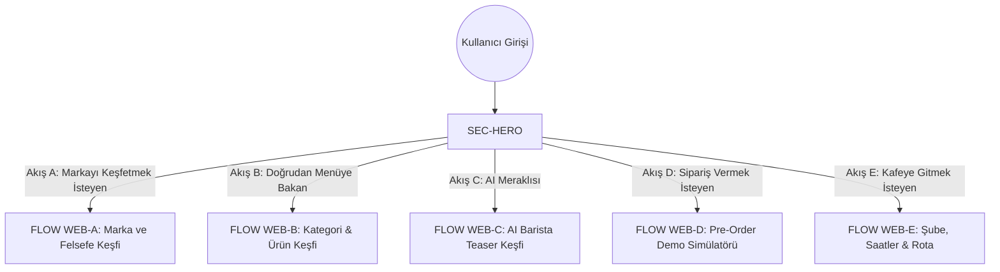
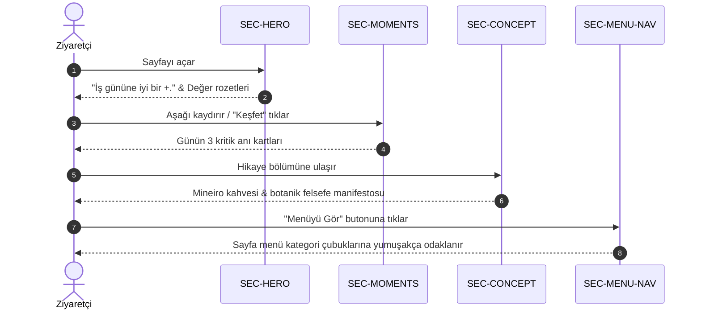
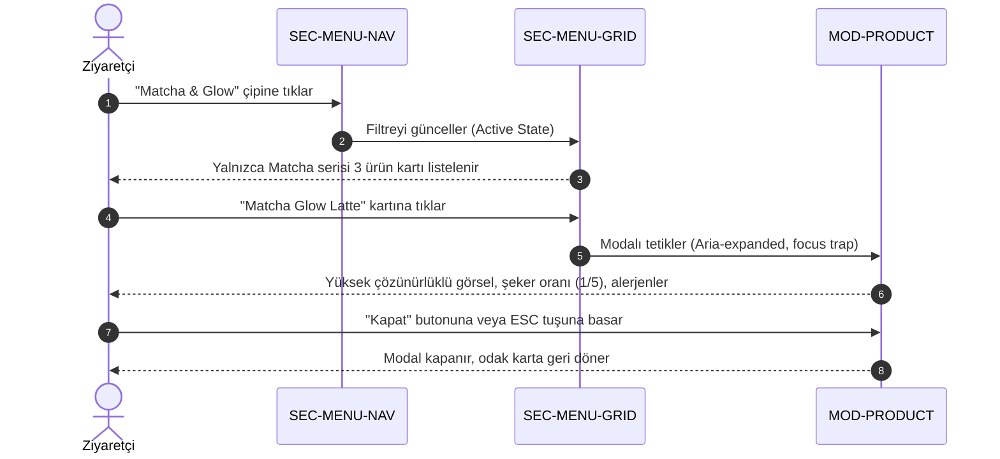
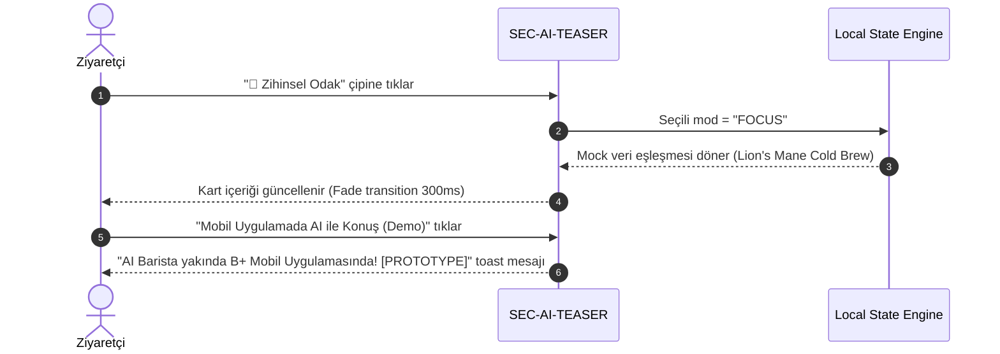
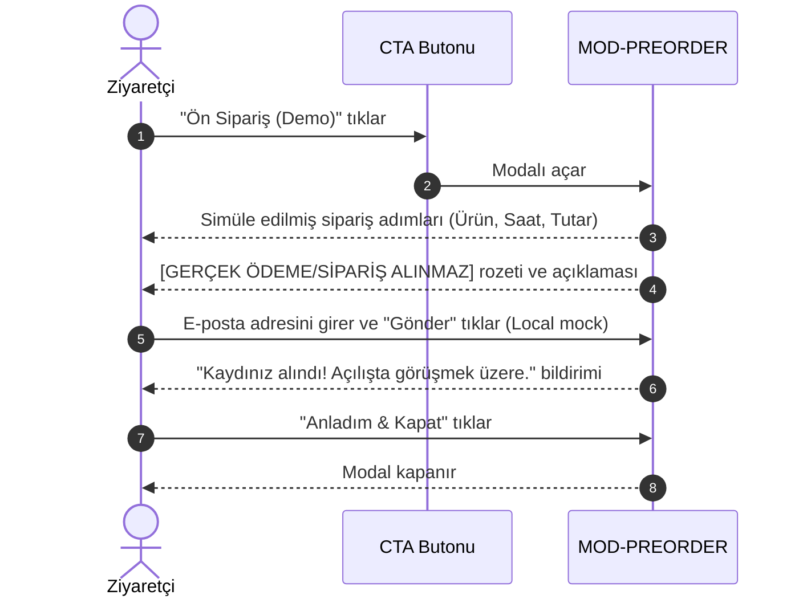
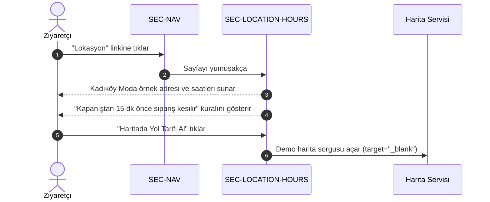

# B+ Wellness Café — Web User Flows

**Workstream:** Website Workstream — Web Phase 1  
**Doküman Sürümü:** 1.0.0 (User Flows Specification)  
**Tarih:** 2026-10-04  
**Statü:** APPROVED — UX USER FLOWS  
**Roller:** Senior UX Architect, Senior Product Designer, Information Architect  

---

## 1. Genel Bakış ve Akış Haritası

B+ Wellness Café web sitesi, kullanıcının niyetine göre 5 temel etkileşim ve keşif akışını destekler. Tüm akışlar **Single-Page Application (SPA)** bağlamında sayfa yenilenmeden, yumuşak geçişler ve odak korumalı modallarla gerçekleşir.

---

## 2. FLOW WEB-A — Marka ve Felsefe Keşfi (Brand Discovery)

### 2.1. Kullanıcı Amacı
Ziyaretçi B+ markasını ilk defa duymuştur; konseptin ne olduğunu, neden "Wellness Café" dendiğini ve Mineiro Coffee ile bağlantısını anlamak istemektedir.

### 2.2. Akış Adımları ve Sistem Yanıtı
1. **Giriş:** Kullanıcı ana sayfaya iniş yapar (`SEC-HERO`).
2. **Değer Önerisi Algısı:** *"İş gününe iyi bir +."* sloganını ve tek kökenli nitelikli kahve + adaptojen vaadini okur (3-5 saniye).
3. **Kaydırma / Eylem:** Kullanıcı `SEC-HERO` altındaki `Konsepti İncele` butonuna basar veya aşağı kaydırır.
4. **Anlar ile Özdeşleşme (`SEC-MOMENTS`):** 08:00 (uyanış/odak), 12:30 (hafif öğle arası) ve 15:00 (ikinci rüzgar) kartlarını inceler.
5. **Hikaye & Felsefe (`SEC-CONCEPT`):** Mineiro ustalığı, katkısız rafine şekersiz reçeteler ve hızlı gel-al felsefesini öğrenir.
6. **Sonuç / Geçiş:** `SEC-CONCEPT` altındaki `Menüyü Keşfet` linkiyle pürüzsüzce menüye akar.

---

## 3. FLOW WEB-B — Menü & Ürün Keşfi (Menu Discovery)

### 3.1. Kullanıcı Amacı
Kullanıcı ne içebileceğini, fiyat düzeyini, içerik temizliğini ve alerjen durumunu incelemek ister.

### 3.2. Akış Adımları ve Sistem Yanıtı
1. **Kategori Seçimi (`SEC-MENU-NAV`):** Kullanıcı kategori çiplerinden birine (örn: `Matcha & Glow` veya `Kahveler`) tıklar.
2. **Filtre Güncellemesi:** Menü gridi (`SEC-MENU-GRID`) sayfa yenilenmeden ilgili ürünleri listeleyecek şekilde anlık olarak filtrelenir (animasyon süresi: 250ms).
3. **Ürün Kartı İnceleme:** Listelenen ürün kartlarındaki diyet etiketlerine (Vegan, Rafine Şekersiz vb.), görseline ve `₺XX [DEMO]` fiyatına bakar.
4. **Detay Talebi:** Ürün kartındaki `Detaylı İncele` butonuna veya karta tıklar.
5. **Modal Açılışı (`MOD-PRODUCT`):** Ekran karartılır, ürün detay modalı açılır:
   - Şeker seviyesi ve gövde/asidite puanları.
   - Tam botanik reçete ve organik içerikler.
   - Alerjen uyarısı ve `DEMO DATA — NON-PRODUCTION` etiketi.
6. **Kapanış:** Kullanıcı `✕` butonu, ESC tuşu veya dış tık ile modalı kapatır; menüdeki önceki konumuna odak korunarak döner.

---

## 4. FLOW WEB-C — AI Barista Deneyimi (AI Discovery)

### 4.1. Kullanıcı Amacı
Kullanıcı web sitesindeki teknolojik yeniliği merak eder ve ruh haline göre kişiselleştirilmiş bir ürün önerisi görmek ister.

### 4.2. Akış Adımları ve Sistem Yanıtı
1. **Bölüme Varış (`SEC-AI-TEASER`):** Kullanıcı "Bugün Zihnin ve Bedenin Ne İstiyor?" başlığına gelir.
2. **Mod Seçimi:** Sunulan 3 ruh hali çipinden birini seçer:
   - `🧠 Zihinsel Odak`
   - `🧘 Sakinleşme & Zen`
   - `⚡ Temiz Enerji & Canlanma`
3. **Öneri Üretimi (Local Simulation):** Hiçbir dış API çağrısı yapılmaksızın, seçilen moda eşleşen mock kart yumuşak geçişle ekrana yansır (örn: *Matcha Collagen Zen Latte — %98 Eşleşme*).
4. **ADR-004 Grounding Notu:** Öneri kutusunun altında *"Yapay zekamız yalnızca menümüzdeki gerçek ürünleri önerir"* bilgilendirmesi görünür.
5. **Aksiyon:** Kullanıcı `Mobil Uygulamada AI ile Konuş (Demo)` butonuna tıklar.
6. **Sonuç:** Mobil uygulamanın yapay zeka barista özelliğini tanıtan kısa bilgilendirme bildirimi gösterilir.

---

## 5. FLOW WEB-D — Ön Sipariş Simülatörü (Pre-Order Demo)

### 5.1. Kullanıcı Amacı
Kullanıcı web üzerinden kahve sipariş etmek, ödeme yapmak veya gel-al sürecinin nasıl işlediğini anlamak ister.

### 5.2. Akış Adımları ve Sistem Yanıtı
1. **Tetikleme:** Navigasyondaki `Ön Sipariş (Demo)` veya `SEC-PREORDER-DEMO` içindeki `Ön Sipariş Deneyimini Gör` butonuna basar.
2. **Modal Açılışı (`MOD-PREORDER`):** Demo sipariş penceresi ekrana gelir.
3. **Simüle Edilen Adımlar:**
   - **Adım 1:** Örnek seçili ürün gösterilir (*Lion's Mane Cold Brew*).
   - **Adım 2:** Tahmini gel-al saati seçimi (*10 dk sonra / 08:45*).
   - **Adım 3:** Sipariş özeti ve Kadıköy Moda örnek şubesi listelenir.
4. **Net Demo Sınırı Bildirimi:**
   - Modal içerisinde belirgin kırmızı/amber rozet yer alır:  
     `[PROTOTİP MODU — GERÇEK SİPARİŞ / ÖDEME ALINMAZ]`
   - Metin: *"Bu web sitesi konsept vitrinidir. Gerçek sipariş şube açılışıyla birlikte B+ Müşteri Mobil Uygulaması üzerinden alınacaktır."*
5. **Hafif E-posta Kaydı (Opsiyonel):** Kullanıcı açılış günü indiriminden haberdar olmak isterse e-posta kutucuğunu doldurur.
6. **Kapanış:** `Anladım & Kapat` butonu ile modal kapatılır.

---

## 6. FLOW WEB-E — Mağaza & Lokasyon Keşfi (Store Discovery)

### 6.1. Kullanıcı Amacı
Kullanıcı kafenin adresini, çalışma saatlerini, sipariş kesilme kuralını öğrenmek ve yol tarifi almak ister.

### 6.2. Akış Adımları ve Sistem Yanıtı
1. **Gezinme:** Kullanıcı üst menüden `Lokasyon` linkine basar veya sayfayı aşağı kaydırır.
2. **Bölüm Görünümü (`SEC-LOCATION-HOURS`):**
   - Şube Adı: `Kadıköy / İstanbul — ÖRNEK LOKASYON (TBD — EMPLOYER DATA REQUIRED)`
   - Durum: `[KURULUM AŞAMASINDA — DEMO]`
   - Adres: `Moda Caddesi No: 42 (DEMO ADDRESS / TBD)`
   - Çalışma Saatleri: Hafta içi 07:30 – 22:00, Hafta sonu 08:30 – 23:00 `[DEMO VALUE ONLY / TBD]`
   - Sipariş Kesilme Süresi: Kapanıştan 15 dk önce `[DEMO VALUE ONLY / CONFIGURABLE — DEC-10]`
3. **Harita Kartı Etkileşimi:** Kullanıcı statik örnek krokiyi inceler.
4. **Rota Aksiyonu:** `Haritada Yol Tarifi Al (Demo)` linkine basar.
5. **Sistem Yanıtı:** Kullanıcıya örnek harita koordinatları üzerinden yeni sekmede harici arama açılır veya demo bağlantı uyarısı verilir.

