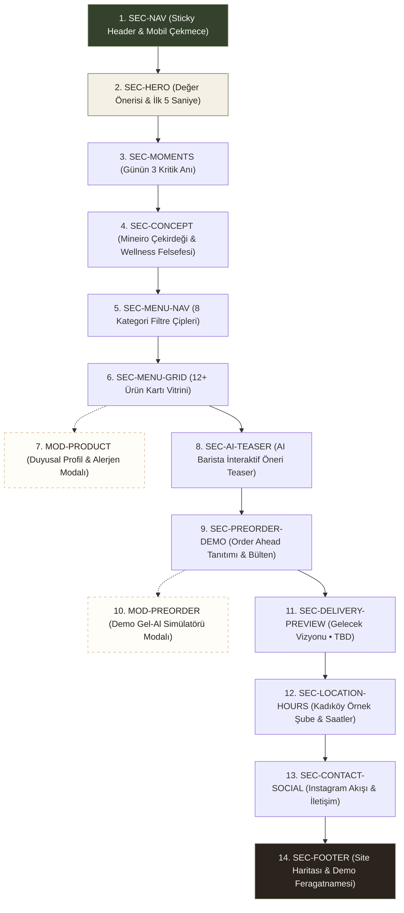

# B+ Wellness Café — Web UX Blueprint & Experience Architecture

**Workstream:** Website Workstream — Web Phase 1  
**Doküman Sürümü:** 1.0.0 (Web Phase 1 Blueprint)  
**Tarih:** 2026-10-04  
**Statü:** APPROVED — UX BLUEPRINT  
**Roller:** Senior UX Architect, Senior Product Designer, Senior Web Experience Designer, Information Architect  

---

## 1. Executive Summary & UX Strategy

B+ Wellness Café web sitesi, modern şehirli beyaz yakalı profesyonellerin yoğun iş günlerine ritim, hafiflik ve zihinsel ferahlık katan **üçüncü nesil nitelikli kahve ve fonksiyonel wellness deneyiminin** dijital pazarlama vitrinidir.

Web deneyimi, kullanıcının vaktini çalmayan, yüksek taranabilirlik (high scannability), dingin renk dengesi (calm aesthetics) ve editorial prestij sunan **Mobile-First Single-Page Application (SPA) / Deneyim Mimarisi** üzerine kurgulanmıştır.

### 1.1. Deneyimin Temel Duygu ve Nitelikleri (Emotional & Functional Pillars)
1. **Hızlı & Taranabilir (Fast & Effortless):** Ziyaretçi 5 saniyede değer önerisini kavrar; tek kaydırmayla günün kritik anları, menü ve lokasyona ulaşır.
2. **Sakin & Dingin (Calm & Grounded):** Agresif pop-up'lar veya parlak e-ticaret karmaşası yerine Deep Olive, Cream ve Warm White tonlarıyla zihni dinlendiren ferah bir alan açar.
3. **Editorial & Prestijli (Curated & Elevated):** Ürünler sıradan bir liste değil, duyusal hikayesi, alerjen şeffaflığı ve botanik bileşenleriyle bir yaşam tarzı dergisi özeninde sergilenir.
4. **Şeffaf Prototip Güveni (Honest Demo Boundaries):** Gerçek sipariş veya ödeme almadığı, şubenin kurulum aşamasında olduğu ziyaretçiyi yanıltmadan, berrak rozetlerle ifade edilir.

---

## 2. Hedef Kitle ve İş Günü Ritimleri (Audience & Moments)

Birincil kitle: Metropol temposunda çalışan, masa başı odaklanma gerektiren, kafein çarpıntısı veya ağır yemek rehaveti yaşamadan enerjisini korumak isteyen **şehirli profesyonellerdir**.

```mermaid
journey
    title Şehirli Profesyonelin B+ ile İş Günü Yolculuğu
    section 08:00 Uyanış & İşe Gidiş
      Güne başlama stresi / Sisli zihin: 3: Ziyaretçi
      B+ Cold Brew & Lion's Mane dokunuşu: 5: B+ Deneyimi
      Temiz odak & mideyi yormayan asidite: 5: B+ Etkisi
    section 12:30 Öğle Arası
      Ağır yemek korkusu / Zaman darlığı: 2: Ziyaretçi
      Spirulina Kase & Soğuk Sıkım Zencefil: 5: B+ Deneyimi
      Hafiflik & öğleden sonra rehavetini önleme: 5: B+ Etkisi
    section 15:00 3 PM Dip Kurtarma
      Zihinsel tükeniş / Şeker arayışı: 2: Ziyaretçi
      Matcha Glow Latte & Şekersiz Raw Bar: 5: B+ Deneyimi
      Dengeli ikinci rüzgar & temiz tatlı molası: 5: B+ Etkisi
```

---

## 3. Bölüm Mimarisi ve Hiyerarşik Akış (Section Architecture)

Sitede Web Phase 0 kapsamında dondurulan **14 bileşen (13 ana bölüm/modal + Footer)** eksiksiz yer alır. Bölüm sırası bilişsel algı piramidine göre yapılandırılmıştır:



---

## 4. Birincil Kullanıcı Yolculuğu ve Gezinme Kısayolları

### 4.1. Doğrusal Ziyaretçi Yolculuğu (Core Linear Journey)
1. **İniş (Landing):** Kullanıcı sayfayı açar; Deep Olive / Warm White zemin üzerinde *"İş gününe iyi bir +."* vaadini görür.
2. **Empati (Moments):** 08:00, 12:30 ve 15:00 anlarıyla kendi iş temposunu özdeşleştirir.
3. **Güven & Felsefe (Concept):** Mineiro Coffee çekirdek kalitesi ve katkısız botanik içerik felsefesini öğrenir.
4. **Keşif (Menu Filter & Grid):** İlgilendiği kategoriye tıklar (örn. Matcha & Glow), ürün kartlarını inceler.
5. **Derinleşme (Product Modal):** Merak ettiği ürünü açar; şeker puanını, alerjen durumunu ve içindekileri okur.
6. **İnovasyon Merakı (AI Teaser):** Ruh halini seçerek yapay zeka reçetesini test eder.
7. **Dönüşüm / Heyecan (Pre-Order Demo):** Mobil uygulama gel-al mantığını kavrar, e-posta listesine kaydolur.
8. **Fiziksel Bağlantı (Location & Hours):** Örnek lokasyonun (Kadıköy Moda) nerede olduğunu ve tahmini saatleri öğrenir.
9. **Kapanış (Footer):** Demo bildirimini görerek şeffaf bir deneyimle siteden ayrılır veya sosyal medyaya geçer.

### 4.2. Gezinme Çubuğu Kısayolları (Navigation Anchor Shortcuts)
Zamanı kısıtlı kullanıcılar üst gezinme çubuğundaki direkt çıpalarla dilediği bölüme atlayabilir:
- `Konsept` ➔ `#concept` (Pürüzsüz kaydırma)
- `Menü` ➔ `#menu` (Kategori seçiciye odaklanır)
- `AI Barista` ➔ `#ai-barista`
- `Lokasyon` ➔ `#location`
- `CTA: Menüyü Keşfet` (Desktop P0 CTA) ➔ Doğrudan `#menu` alanına yumuşak geçiş yapar.

---

## 5. Responsive Hiyerarşi Özeti

| Ekran Tipi | Genişlik Bazı | Düzen & Hiyerarşi Yaklaşımı | Menü / Grid Davranışı |
| :--- | :--- | :--- | :--- |
| **Mobile** | `375px` (320px–480px) | Tek sütunlu dikey akış; yapışkan başlıkta logo + hamburger; anlar yatay kaydırılabilir karusel veya dikey kart. | Menü çipleri yatay snap-scroll; ürünler tek sütun dikey liste (`1 col`). |
| **Tablet** | `768px` (481px–1024px) | 2 sütunlu asimetrik grid; genişletilmiş padding; üst barda temel linkler görünebilir veya kompakt çekmece. | Menü çipleri sarıcı satır (flex-wrap); ürünler 2 sütun (`2 col`). |
| **Desktop** | `1440px` (1025px+) | 12 sütunlu editorial ızgara; split hero (sol metin / sağ görsel); tam üst gezinme ve kalıcı CTA. | Sabit üst filtre barı; ürünler 3 veya 4 sütunlu zengin vitrin (`3-4 col`). |

---

## 6. Demo Sınırları ve İletişim İlkeleri

- **Tıbbi Beyan Yasağı:** "Odaklanmayı artırır", "detoksifiye eder", "hastalık önler" gibi iddialar bulunmaz. Dil tamamen duyusal (*"mideyi yormayan asidite"*, *"odaklanma anlarına eşlik eden botanikler"*) tutulur.
- **Sipariş & Ödeme Yokluğu:** Hiçbir sepet veya kart formu sunulmaz. Ön sipariş butonları doğrudan bilgilendirici `MOD-PREORDER` bileşenine bağlanır.
- **Şube ve Saat Sınırları:** Kadıköy şubesi `ÖRNEK LOKASYON / TBD`, saatler ve cutoff kuralı `DEMO VALUE ONLY / TBD` olarak etiketlenir.
- **Design System Bütünlüğü:** Tüm renkler ve boşluklar mobil prototip ile %100 uyumlu mevcut tasarım jetonlarından (`color.primary.olive`, `color.surface.cream`, vb.) türetilir.
